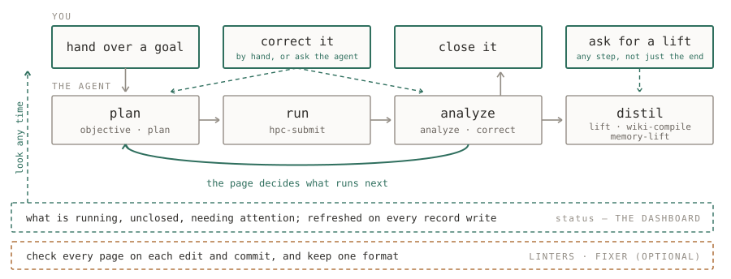

# research-note

[](https://github.com/Chi-RZ/research-note/actions/workflows/test.yml)
[](LICENSE)

A record framework for agent-assisted computational research, for **Claude
Code** and **Codex**. It records numerical results faithfully, and distils
source code and knowledge as the work proceeds.

## What it is for

- A record that ties each result to its code, recipe, machine, and question.

- A page for supervising long runs. The page survives a finished or compacted
  session, and only you close an entry.

- A shared memory and knowledge base for the project.

- A concise layer you can share with collaborators.

## A typical run

You hand over a goal or a plan; the agent runs it and records the results and
the analysis on a page, for you to review and correct.

<picture>
  <source media="(prefers-color-scheme: dark)" srcset="docs/typical-run-dark.svg">
  
</picture>

## Requirements

- Claude Code or Codex
- git and Python 3.10 or newer
- [uv](https://docs.astral.sh/uv/) — the plugin manages your project's Python
  environment with it (see [Python environment](#python-environment)). If it is
  not installed, setup offers to install it.

## 1. Install

**Claude Code**

```bash
claude plugin marketplace add https://github.com/Chi-RZ/research-note.git
claude plugin install research-note@research-tools
```

**Codex**

```bash
codex plugin marketplace add https://github.com/Chi-RZ/research-note.git
codex plugin add research-note@research-tools
```

If you use both agents, install it in each.

## 2. Set up a project

Open the directory you want to work in, new or with existing code, and tell the
agent:

> set up this project with research-note

The agent shows how it will map your directories and asks you to confirm before
it writes anything. You get:

- the record, `project_memory/`, where every result gets a page;
- one instruction file per directory, read by Claude as `CLAUDE.md` and by
  Codex as `AGENTS.md`, with a section at the end for your project's own rules;
- git hooks that keep each commit to one part of the project;
- checks, run on every edit and every commit, that keep each record page
  complete and in one format.

If the project has a git remote, each record entry is pushed to it as soon as
it is committed. Code commits are left for you to push.

Setup runs bootstrap once, then a read-only installation check. A dry run is
available on request; doctor is used for diagnosis if a check fails.
Dashboard generation is off for new projects. Existing projects keep their
previous behavior until explicitly disabled with `--no-dashboard`.

An existing project keeps its own layout. You tell the agent which directories
hold code, tests and experiments, and nothing is moved. A `CLAUDE.md` you
already had becomes the rules section, and your existing git hooks keep running.
Setup does not reorganize your code; if you later want the default layout, move
things yourself in an ordinary commit.

Everything else is optional. Mention it in the same request:

| Say | You get |
|---|---|
| "with a dashboard" | an HTML status view, refreshed after record writes |
| "with a cluster at `host:/path`" | cluster settings and job submission there |
| "with the fixer" | a background scanner that flags forgotten work and keeps job status current |
| "with editor support" | VS Code extensions; also request the dashboard to use its viewer |
| "for both agents" | registration with the other installed agent |

**Clusters.** Setup asks which partition, reservation and account your jobs
should use, and records them once. It then clones the project onto the cluster
without the record, so the record lives in one place. The project needs a git
remote for this, because code reaches the cluster through `git pull`.

### Python environment

uv manages it. `pyproject.toml` and `uv.lock` are committed; each machine builds
its own `.venv` from them, jobs run through `uv run`, and every job's log header
names the lock it ran under. That lock is what lets a recorded result be rerun
in the same environment. Setup installs uv if it is missing, after asking you.

## 3. Update

In a project, tell the agent:

> update research-note

It pulls the newest plugin from GitHub into the agent you are using, then
brings that one project up to it: its instruction files, git hooks and settings. Other
projects stay on their version until you update them. The other agent is left
alone; update it yourself when you are ready — for Codex that moves every
project you use from Codex, since Codex keeps one version per machine:

```bash
claude plugin marketplace update research-tools && claude plugin update research-note@research-tools
codex plugin marketplace upgrade research-tools && codex plugin add research-note@research-tools
```

Your rules sections are kept, and a project from an earlier version is
migrated on its first update. Ask for a dry run to see the
changes first. Nothing is committed for you: review the output and commit it
yourself.

MIT licensed.
