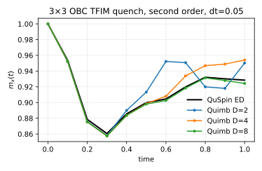

### Entry: second-order plus-state quench at D 2 4 8
- **Id:** 01.003
- **Status:** closed
- **Date:** 2026-10-08 13:30
- **Code:** `research-note@4dbcfb0`
- **Motivation:** The ground-state scan found "D=4 and D=8 sit on a non-monotonic energy plateau"; how does the maximum absolute error in transverse magnetization through `t=1` change across `D=[2,4,8]`?
- **Recipe:** {Lx: 3, Ly: 3, boundary: open, J: 1.0, h: 3.0, initial_state: +x product, dt: 0.05, t_max: 1.0, measure_every: 0.1, D: [2, 4, 8], trotter: second-order X/ZZ/X, cutoff: 1e-12}
- **Facts:** We evolved the same quench with QuSpin and PEPS circuit simple update using [run_dynamics.py](../../../../experiments/peps_simple_update/impl/run_dynamics.py); evidence [log](../../../../experiments/peps_simple_update/tfim_3x3/dynamics/run.log) and [JSON](../../../../experiments/peps_simple_update/tfim_3x3/dynamics/magnetization.json).

  | D | max absolute error in mx(t) | mx(1) | exact mx(1) |
  |---:|---:|---:|---:|
  | 2 | 4.7704e-2 | 0.950179 | 0.928462 |
  | 4 | 2.5553e-2 | 0.954015 | 0.928462 |
  | 8 | 4.1395e-3 | 0.924323 | 0.928462 |

  
  *Transverse magnetization versus time for QuSpin ED and Quimb simple update at D=2, 4 and 8.*

- **Conclusion:** The result shows real-time accuracy continues to improve through D=8, because the maximum `mx(t)` error falls from `4.77e-2` at D=2 to `4.14e-3` at D=8; this answers the motivation through `t=1`, with the boundary that timestep and truncation errors are not separated.
