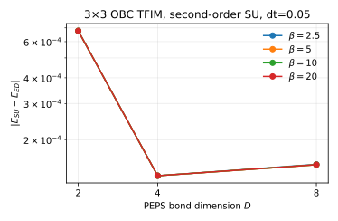

### Entry: second-order ground-state scan at D 2 4 8
- **Id:** 01.002
- **Status:** analyzed
- **Date:** 2026-10-08 13:10
- **Code:** `research-note@4dbcfb0`
- **Motivation:** The user directive found "the requested comparison fixes `Lx=3`, `dt=0.05`, second order and `D=[2,4,8]`"; how far does the absolute energy error from QuSpin ED fall at `beta=20`?
- **Recipe:** {Lx: 3, Ly: 3, boundary: open, J: 1.0, h: 3.0, dt: 0.05, steps: 400, beta: 20, D: [2, 4, 8], ordering: sort, second_order_reflect: true, initial_state: +x product, cutoff: 1e-12}
- **Facts:** We evolved each bond dimension continuously and measured with exact 3×3 PEPS contractions using [run_convergence.py](../../../../experiments/peps_simple_update/impl/run_convergence.py); evidence [log](../../../../experiments/peps_simple_update/tfim_3x3/results/run.log) and [JSON](../../../../experiments/peps_simple_update/tfim_3x3/results/convergence.json).

  | D | energy at beta=20 | absolute error from ED |
  |---:|---:|---:|
  | ED | -28.074198890889 | 0 |
  | 2 | -28.073522020467 | 6.7687e-4 |
  | 4 | -28.074065259227 | 1.3363e-4 |
  | 8 | -28.074047747662 | 1.5114e-4 |

  
  *Absolute total-energy error against D at beta 2.5, 5, 10 and 20; all curves are measured against the QuSpin ED energy.*

- **Conclusion:** The result shows the fixed simple-update schedule improves by about fivefold from D=2 to D=4 but reaches a non-monotonic error plateau near `1.5e-4` at D=8, because every arm is already stationary by `beta=5` while the D=8 energy is slightly above D=4; this answers the motivation for this lattice, timestep and ordering but does not establish monotonic convergence beyond D=8.
